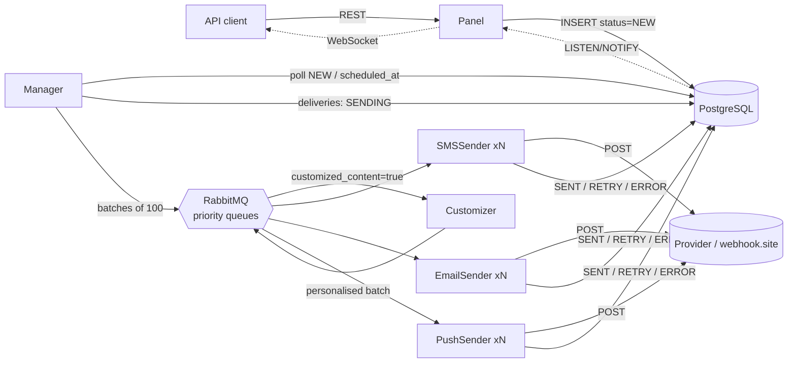

# Event-Driven Notification System

A notification platform written in Go that delivers SMS, Email and Push messages through an
external provider. It is built for burst traffic, retries failed deliveries, and shows the
status of every request in real time.

- **Go 1.24**, **PostgreSQL 16** (plain SQL through `pgx`, **no ORM**), **RabbitMQ 3.13**
- 6 independent services, each with its own folder and runner (`<service>/cmd/main.go`)
- One-command setup with Docker Compose, versioned migrations, OpenAPI docs, CI pipeline

---

## Quick start

```bash
cp .env.example .env          # then set real passwords
docker compose up --build     # or: make up
```

| What                    | URL                                      |
|-------------------------|------------------------------------------|
| Panel API               | http://localhost:8080/api/v1             |
| Swagger UI              | http://localhost:8080/swagger            |
| Real-time metrics (JSON)| http://localhost:8080/api/v1/metrics     |
| WebSocket status stream | ws://localhost:8080/ws/notifications     |
| RabbitMQ management     | http://localhost:15672                   |
| Jaeger (traces)         | http://localhost:16686                   |
| Prometheus              | http://localhost:9090                    |

Messages are delivered to the external provider simulated by **webhook.site**, configured
with `PROVIDER_URL` in `.env`. Configure the webhook to answer
`202 {"messageId","status":"accepted","timestamp"}`; any 2xx is treated as accepted, 5xx /
429 / 408 / network errors are retried and other 4xx fail permanently. You can also set a
URL per channel with `SMS_PROVIDER_URL`, `EMAIL_PROVIDER_URL` and `PUSH_PROVIDER_URL`.

```bash
make test        # unit tests (go test -race ./...)
make test-docker # the same tests inside the golang image, no local Go needed
make e2e         # end-to-end smoke test against the running stack
```

---

## Architecture



| Service | Folder | Responsibility |
|---|---|---|
| **Panel** | `panel/` | REST API. Validates requests (audience, content, recipients), stores them as `NEW`, and serves status, deliveries, logs, metrics, the WebSocket stream and Swagger. |
| **Manager** | `manager/` | Processing engine. Polls due `NEW` notifications, resolves the audience, writes a delivery row per recipient and produces batches of up to 100 recipients. Also runs crash recovery, retry scheduling, completion and the stuck-delivery sweeper. |
| **Customizer** | `customizer/` | Replaces `{{variables}}` with each recipient's `master_contact` values, then forwards the batch to the channel's sender queue. |
| **SMSSender / EmailSender / PushSender** | `smssender/` `emailsender/` `pushsender/` | Competing consumers of their channel queue. They send through the provider under the global rate limit and record every outcome. |

Each service keeps its parts in separate folders: `cmd/` (runner), `config/`, `dto/`,
`queries/` (all SQL), `repository/`, `request/`/`response/`, plus folders for its own logic
(`service/`, `worker/`, `consumer/`, `provider/`, …). `pkg/` holds only shared
infrastructure: logger, Postgres pool, RabbitMQ client, tracing, health server and the rate
limiter.

### Notification lifecycle

```
AUDIENCE_CALCULATING ──(background count done)──┐   (only when counting exceeded the API timeout)
                                                ▼
NEW ──(Manager claims)──> PROCESSING ──(all batches produced)──> SENDING ──(no pending deliveries)──> COMPLETE
 │                            │                                    │
 └───────── CANCELLED <───────┴────────────────────────────────────┘        any ──> ERROR (permanent failure)
```

Each recipient gets a row in a per-channel table (`sms_deliveries`, `email_deliveries`,
`push_deliveries`):

```
SENDING ──> SENT
   │
   └──> RETRY (retry_count++, next_retry_at = now + 10m) ──(Manager re-produces)──> SENDING ...
            └── retry_count reaches 3, or the provider returns a permanent 4xx ──> ERROR
```

### Processing flow

1. **Panel** validates the request and inserts it with status `NEW`. It can also have a
   `scheduled_at`, an `idempotency_key` and a priority.
2. **Manager** polls on an interval (`MANAGER_POLL_INTERVAL`, default 2s). It claims
   notifications with `UPDATE … WHERE id IN (SELECT … FOR UPDATE SKIP LOCKED)`, which means
   several Manager replicas never claim the same row. Rows come out by `priority`, then
   `created_at`, and only once `scheduled_at <= now()`. A claimed row moves to `PROCESSING`.
   Immediate and scheduled rows are read through two partial indexes, so notifications
   scheduled for the future are never scanned (with 100k future rows the poll went from
   6.6 ms, scanning all of them, to 0.04 ms). When a worker finishes, the Manager polls again
   right away instead of waiting for the next tick.
3. Manager streams the audience through a server-side cursor in chunks of 100. For each
   chunk it:
   - writes the delivery rows as `SENDING` (`INSERT … ON CONFLICT DO …`, which is idempotent),
   - publishes **one queue message holding at most 100 recipients** (persistent, with
     publisher confirms, and the AMQP priority taken from the notification).

   Batches go to the channel queue, or to the Customizer queue when
   `customized_content=true`.
4. After the last batch the notification becomes `SENDING` with its `total_recipients`.
5. A **sender** claims the recipients in the batch, sends them under the rate limit and
   marks each one `SENT`, `RETRY` or `ERROR`. When nothing is pending any more it sets the
   notification to `COMPLETE`. The Manager's finalizer loop catches any races.

### Delivery & retry design

| Concern | How it is handled |
|---|---|
| **One consumer per message** | Every replica of a sender consumes the *same* durable queue (competing consumers), with manual acks and a prefetch limit. RabbitMQ gives each message to exactly one consumer. If a consumer dies, its unacked messages go to another one. |
| **No duplicate sends** | Before sending, a sender *claims* its rows: `UPDATE … SET locked_until = now()+lease WHERE status='SENDING' AND (locked_until IS NULL OR locked_until < now())`. A redelivered or duplicate message therefore cannot send a row twice, and cancelled rows are skipped. The provider also gets an `Idempotency-Key: <channel>-<deliveryId>-<attempt>` header. |
| **Idempotent API** | `idempotency_key` in the body, or the `Idempotency-Key` header, is backed by a unique constraint. Re-posting the same key returns the original notification with `200` and `duplicate=true`. |
| **Rate limit: 100 msg/s per channel** | A distributed fixed-window limiter lives in PostgreSQL (`acquire_rate_tokens()`, using the database clock). It holds across **all replicas**: in the load test, 1000 SMS through 2 sender replicas came out at about 95 SENT per second. Each queue message is also capped at 100 recipients. |
| **Retries** | A retryable failure (5xx, 429, 408, timeout, network error) sets the row to `RETRY` with `next_retry_at = now() + SENDER_RETRY_DELAY` (10m). The Manager's retry scheduler re-produces due rows. On the third failure (`SENDER_MAX_RETRIES=3`) the row becomes `ERROR`. A permanent 4xx goes straight to `ERROR`. |
| **Manager crash** | While processing, the Manager updates a `heartbeat_at` column. At startup, and then every 15s, it reclaims `PROCESSING` rows whose heartbeat is older than 30s, so a Manager that died mid-way is picked up. Re-processing is safe because of the delivery upsert and the sender claim. After `MANAGER_MAX_PROCESSING_ATTEMPTS` (5) attempts the notification becomes `ERROR`. Errors in the audience SQL itself are permanent and fail it immediately. |
| **Lost / dead-lettered messages** | Each queue has a DLQ. The *sweeper* moves rows stuck in `SENDING` longer than `MANAGER_STALE_SENDING_AFTER` (30m, with no active lease) back to `RETRY`, and this does not use up a retry attempt. |
| **Cancellation** | `POST /notifications/{id}/cancel` works while the notification is `NEW`, `PROCESSING` or `SENDING`. It cancels pending deliveries in the same transaction. The Manager checks for cancellation before every batch. |
| **Data retention** | A Manager loop deletes notifications (and their deliveries) that finished more than `MANAGER_RETENTION_DAYS` (730) days ago, and audit logs older than that, in batches of `MANAGER_RETENTION_BATCH_SIZE` (5000) with `SKIP LOCKED`. Notifications still in progress, and their logs, are never deleted. `0` keeps everything. Deleted notifications answer `404`. |
| **Priority** | Polling orders by priority. The queues are RabbitMQ priority queues (`x-max-priority=10`): high=9, normal=5, low=1. |

### Audiences

| Type | Description | Validation |
|---|---|---|
| `SQL` | A raw `SELECT` that returns an `id` column of `master_contact`. | Static checks: a single statement, `SELECT`/`WITH` only, no DML/DDL keywords, comments, `$`-quoting or dangerous functions, and it must reference `master_contact`. The query is then **executed** as the read-only `audience_reader` role, in a `READ ONLY` transaction with a statement timeout, and joined to `master_contact` to count real contacts. The role can `SELECT` only the contact tables, so `SELECT … FROM notifications` fails with *permission denied*. |
| `FILTER` | Column conditions on `master_contact`, optionally joined to a whitelisted table that has a `contact_id` column (e.g. `contact_purchases`). | Tables and columns are checked against `information_schema`, operators against a whitelist, and values are escaped. The SQL is generated and then counted the same way. |
| `GROUP` | A saved audience group. | Validated **once, when the group is created**. It is not validated again when used. |
| `DIRECT` | An explicit list of addresses. | E.164 phone numbers, RFC 5322 emails, or device tokens. Duplicates are removed. |

The Manager runs audience SQL as the same read-only role. Contacts that are inactive or have
no address for the channel are skipped. **Every address receives the notification once**:
when several contacts share a phone, email or device token, the contact with the lowest id is
used (for personalisation too). Emails are compared case-insensitively and addresses are
trimmed. Batches are de-duplicated again before they are written, so shared addresses can
never fail a notification.

**Slow audiences.** The Panel counts SQL / FILTER audiences synchronously within
`PANEL_AUDIENCE_VALIDATION_TIMEOUT` (10s; a batch request shares one budget). If counting
takes longer:

- the notification is stored with status **`AUDIENCE_CALCULATING`** and the API answers
  **`202 Accepted`** with a message (a batch answers 202 when any item is calculating);
- the Panel's background **audience calculator** counts it again with
  `PANEL_AUDIENCE_BACKGROUND_TIMEOUT` (30m). Work is claimed with `SKIP LOCKED` and a
  heartbeat lease, so several Panel instances share it and a crashed instance's work resumes;
- when the count is done the notification becomes `NEW` (with `audience_count`) and the
  normal flow continues; an empty audience, a database rejection or a second timeout moves it
  to `ERROR`;
- `GET /api/v1/notifications/{id}`, the list and the WebSocket show `AUDIENCE_CALCULATING`
  meanwhile; it can be cancelled like a `NEW` notification. The audit log records
  `AUDIENCE_CALCULATION_DEFERRED / STARTED / CALCULATED / FAILED`.

Operations that cannot continue in the background (the `/audiences/validate` dry-run and saving
an audience group) answer `504 audience_timeout` instead.

### Content & templates

- Channel tables: `sms_content`, `email_content`, `push_content`. A notification uses either
  a stored, pre-validated `content_id` or an inline `content`, which is validated on the spot.
- Limits: SMS body ≤ 480 characters (3 segments). Email subject ≤ 255 and body ≤ 100k.
  Push title ≤ 100, body ≤ 500, `data` ≤ 4KB, and `image_url` must be http(s).
- **Template variables**: `{{column}}` or `{{column|default}}`, where `column` must be a
  `master_contact` column. Content that contains variables must set
  `customized_content=true`. The batches then go through the **Customizer**, which renders
  each recipient from `master_contact`. It HTML-escapes values in HTML emails, re-checks the
  channel limits after rendering, and marks recipients that cannot be personalised as
  `ERROR`.

### Observability

- **Real-time metrics**: `GET /api/v1/metrics?window=300` returns queue and DLQ depth,
  consumers, sent/failed/retrying counts per channel, success and failure rates, average and
  p95 latency, and notification counts by status.
- **Prometheus** `/metrics` on every service: HTTP latency, provider latency, deliveries by
  result, batches, retries and in-flight processing.
- **Structured JSON logs** (`slog`). Every line includes `correlation_id`, `trace_id` and
  `span_id`. The correlation id comes from the `X-Correlation-ID` header (or is generated),
  is stored on the notification and travels in AMQP headers to every service.
- **Audit log table**: `notification_logs`, written by every service (created, processing,
  each produced batch, customization, each delivery outcome, retries, completion). Read it
  with `GET /api/v1/notifications/{id}/logs`.
- **Distributed tracing**: OpenTelemetry → Jaeger. **One notification is one trace, end to
  end**, including scheduled sends, retries and completion:
  - The Panel stores the W3C trace context of the API request on the notification
    (`notifications.trace_context`). The Manager is reached by polling the database, not by
    a message, so it restores that context and continues the same trace. The retry
    scheduler, finalizer and sweeper do the same, so a retry 10 minutes later is still part of
    the original trace.
  - Between services the context travels in RabbitMQ headers (producer span → consumer span)
    and in the `traceparent` header of provider calls.
  - Spans: the HTTP request, `panel.resolve_content` / `panel.resolve_audience`, every SQL
    statement / batch / COPY (pgx tracer), `manager.process_notification`,
    `manager.produce_batch`, publish / consume per queue, `customizer.personalise_batch`,
    `<sender>.send_batch`, `ratelimit.acquire`, one `provider.send` per recipient,
    `manager.schedule_retry`, `manager.complete_notification`.
  - Every response and audit log row carries the `trace_id`; open it at
    `http://localhost:16686/trace/<trace_id>`. Log lines carry `trace_id` / `span_id` too.
- **Health**: `/health` (liveness) and `/ready` (checks PostgreSQL, RabbitMQ and the time
  zone) on every service.
- **Watchdog (stuck detection)**: the Manager's polling, recovery, retry scheduler, finalizer
  and sweeper loops and the Panel's audience calculator report every iteration to a
  watchdog. A loop that has not ticked for 3 intervals (at least 30s), or a notification /
  calculation that made no progress for longer than its query timeout + 5 minutes, makes
  `/health` answer `503 {"status":"stuck", ...}` naming the loop, so the container is marked
  unhealthy and an orchestrator can restart it. Verified by pausing PostgreSQL: both services
  reported the stuck loop within 40s and recovered on their own afterwards.
- **WebSocket**: `ws://localhost:8080/ws/notifications[?notification_id=…|batch_id=…]`. A
  PostgreSQL trigger fires `NOTIFY` on every status change; the Panel `LISTEN`s and pushes
  each change to subscribers.

### API rate limiting

The Panel limits requests per client IP with token buckets, in two tiers, so a single client
cannot overload the database (every notification request validates its audience with real
queries):

| Tier | Requests | Default |
|---|---|---|
| write | `POST` / `PUT` / `DELETE` under `/api/` | 5 req/s, burst 10 |
| read | `GET` under `/api/` and the WebSocket upgrade | 20 req/s, burst 40 |

`/health`, `/ready`, `/metrics` and `/swagger` are not limited. A rejected request gets
`429 Too Many Requests` with `Retry-After`, `X-RateLimit-Limit` / `X-RateLimit-Remaining`
headers and a `rate_limited` error body; rejected requests do not consume tokens. Rejections
are counted in `panel_http_rate_limited_total{tier}`. Buckets live in memory per Panel
instance; behind a reverse proxy set `API_RATE_LIMIT_TRUST_PROXY=true` to key on
`X-Forwarded-For`.

### Account time zone

Scheduled sends and retries depend on time, so the whole system runs in the **account time
zone**, stored in a key/value `account_settings` table (`timezone` key, default
`Europe/Istanbul`).

- **Database**: a trigger on `account_settings` rejects unknown zones (checked against
  `pg_timezone_names`) and runs `ALTER DATABASE … SET timezone`, so the database default
  always follows the setting.
- **Services**: at startup every service reads the setting, validates it as an IANA zone,
  sets it as the process zone (`time.Local`, used by logs and API responses) and on every
  PostgreSQL session of its pools (a pgx `AfterConnect` hook). It then checks that the
  session zone matches and that its clock is within 5s of the database clock. A missing or
  invalid setting stops the service from starting.
- **Live changes**: `PUT /api/v1/settings/timezone` updates the setting. Every service
  re-reads it every `TIMEZONE_WATCH_INTERVAL` (30s); when it changed, the service shuts
  down cleanly and Docker restarts it with the new zone.
- **API dates**: `scheduled_at` and the `from` / `to` list filters accept RFC3339 with an
  offset (`2026-11-20T09:00:00Z`) or a local date-time without offset
  (`2026-11-20T09:00:00`, `2026-11-20 09:00`), which is read in the account zone. Responses
  carry the account offset (`+03:00`).
- **Containers**: `TZ` in `.env` sets the OS zone of every container. If it differs from the
  account setting the services log a warning and use the account setting.
- **Check it**: `GET /api/v1/system/time` compares the account zone, the service zone, the
  container `TZ`, the database default and session zones and the clock drift, and lists any
  inconsistency.

All times are stored as `timestamptz` (absolute instants), so changing the zone never moves a
scheduled send or a retry; it only changes how times are entered and shown.

---

## API examples

```bash
# Raw SQL audience, high priority
curl -X POST localhost:8080/api/v1/notifications -H 'Content-Type: application/json' \
  -H 'Idempotency-Key: flash-sale-2026-11-19' -d '{
  "channel": "sms", "priority": "high",
  "audience": {"type": "SQL", "sql": "SELECT id FROM master_contact WHERE city = '\''Istanbul'\''"},
  "content": {"body": "Flash sale started!"}
}'

# Filter audience (joined table) + personalised email
curl -X POST localhost:8080/api/v1/notifications -H 'Content-Type: application/json' -d '{
  "channel": "email",
  "audience": {"type": "FILTER", "filter": {"table": "contact_purchases", "conditions": [
    {"field": "contact_purchases.amount", "operator": "gte", "value": 500},
    {"field": "city", "operator": "in", "value": ["Ankara", "Izmir"]}]}},
  "content": {"subject": "Hi {{first_name}}", "body": "<p>Dear {{first_name|Customer}}</p>", "is_html": true},
  "customized_content": true
}'

# Saved audience group + stored content, scheduled for later
curl -X POST localhost:8080/api/v1/notifications -H 'Content-Type: application/json' -d '{
  "channel": "push", "priority": "low", "scheduled_at": "2030-01-01T09:00:00Z",
  "audience": {"type": "GROUP", "group_id": 1}, "content_id": 1
}'

# Batch creation (up to 1000 per request)
curl -X POST localhost:8080/api/v1/notifications/batch -H 'Content-Type: application/json' -d '{
  "notifications": [
    {"channel": "sms", "audience": {"type": "DIRECT", "recipients": ["+905551234567"]}, "content": {"body": "Hi"}},
    {"channel": "push", "audience": {"type": "GROUP", "group_id": 1}, "content_id": 2, "customized_content": true}
  ]}'

# Status, deliveries, logs, batch, list, cancel
curl localhost:8080/api/v1/notifications/{id}
curl "localhost:8080/api/v1/notifications/{id}/deliveries?status=RETRY"
curl localhost:8080/api/v1/notifications/{id}/logs
curl localhost:8080/api/v1/batches/{batchId}
curl "localhost:8080/api/v1/notifications?status=SENDING&channel=sms&from=2026-11-01T00:00:00Z&page=1&page_size=20"
curl -X POST localhost:8080/api/v1/notifications/{id}/cancel

# Audience groups / contents
curl -X POST localhost:8080/api/v1/audiences/validate -H 'Content-Type: application/json' \
  -d '{"channel":"sms","audience":{"type":"FILTER","filter":{"conditions":[{"field":"city","operator":"eq","value":"Bursa"}]}}}'
curl -X POST localhost:8080/api/v1/audience-groups -H 'Content-Type: application/json' \
  -d '{"name":"bursa","type":"SQL","sql":"SELECT id FROM master_contact WHERE city = '\''Bursa'\''"}'
curl -X POST localhost:8080/api/v1/contents/sms -H 'Content-Type: application/json' \
  -d '{"name":"welcome","body":"Hi {{first_name}}, welcome to {{city}}!"}'

# Account settings / time zone
curl localhost:8080/api/v1/settings
curl -X PUT localhost:8080/api/v1/settings/timezone -H 'Content-Type: application/json' -d '{"value":"Europe/Istanbul"}'
curl localhost:8080/api/v1/system/time

# Schedule in local account time (no offset)
curl -X POST localhost:8080/api/v1/notifications -H 'Content-Type: application/json' -d '{
  "channel": "sms", "scheduled_at": "2026-11-20 09:00",
  "audience": {"type": "DIRECT", "recipients": ["+905551234567"]}, "content": {"body": "Good morning"}
}'
```

The full contract is in [`panel/docs/openapi.yaml`](panel/docs/openapi.yaml), also served at `/swagger`.

---

## Database

Migrations are versioned SQL files in `migrations/`. The `migrate` container applies them on
`docker compose up`.

- `000001_init_schema`: contacts, audience groups, content tables, `notifications`, the three
  delivery tables, `notification_logs`, the rate limiter table and function, the status
  `NOTIFY` trigger, and the grants for the read-only audience role.
- `000002_seed_data`: 1000 demo contacts, purchases, sample contents and one audience group
  (`istanbul-gold`).
- `000003_account_settings`: the key/value `account_settings` table, the trigger that
  validates the time zone and applies it to the database, and the default `timezone`.
- `000004_trace_context`: `notifications.trace_context` and `notification_logs.trace_id`,
  which keep the distributed trace across the database hop.
- `000005_audience_calculating`: the `AUDIENCE_CALCULATING` status and
  `notifications.audience_count`.
- `000006_retention_and_pickup_indexes`: separate polling indexes for immediate and scheduled
  notifications, and the index used by data retention.

`deploy/postgres/init` creates the `audience_reader` role on the first start of the
database. Its password comes from `.env`.

## Configuration

Everything is configured through environment variables. Secrets live only in `.env`, which
is git-ignored; `.env.example` is the template. Main settings:

| Variable | Default | Meaning |
|---|---|---|
| `PROVIDER_URL` | (required) | webhook.site URL. `SMS_/EMAIL_/PUSH_PROVIDER_URL` override it per channel. |
| `SENDER_RATE_LIMIT_PER_SECOND` | 100 | Global limit per channel |
| `SENDER_MAX_RETRIES` | 3 | Attempts before a delivery becomes `ERROR` |
| `SENDER_RETRY_DELAY` | 10m | Delay before a failed delivery is retried |
| `MANAGER_BATCH_SIZE` | 100 | Recipients per queue message (max 100) |
| `MANAGER_POLL_INTERVAL` | 2s | Polling interval for NEW / scheduled notifications |
| `MANAGER_WORKERS` | 4 | Notifications processed in parallel per Manager |
| `MANAGER_STALE_PROCESSING_AFTER` | 30s | Heartbeat age after which `PROCESSING` work is recovered |
| `MANAGER_STALE_SENDING_AFTER` | 30m | Age after which stuck `SENDING` deliveries are swept |
| `MANAGER_RETENTION_DAYS` | 730 | Delete finished notifications, their deliveries and old logs after this many days (0 = never) |
| `MANAGER_RETENTION_INTERVAL` / `_BATCH_SIZE` | 1h / 5000 | How often retention runs / rows per delete statement |
| `MANAGER_PROCESSING_STALL_AFTER` | audience timeout + 5m | A notification without progress this long marks the Manager as stuck |
| `PANEL_AUDIENCE_VALIDATION_TIMEOUT` | 10s | Synchronous audience counting budget per API request |
| `PANEL_AUDIENCE_BACKGROUND_TIMEOUT` | 30m | Max duration of a background audience count |
| `PANEL_AUDIENCE_CALC_WORKERS` / `_POLL_INTERVAL` / `_LEASE` | 2 / 5s / 1m | Background audience calculator |
| `API_RATE_LIMIT_ENABLED` | true | Turn the API rate limiter on/off |
| `API_RATE_LIMIT_WRITE_RPS` / `_BURST` | 5 / 10 | Write requests per client IP |
| `API_RATE_LIMIT_READ_RPS` / `_BURST` | 20 / 40 | Read requests per client IP |
| `API_RATE_LIMIT_TRUST_PROXY` | false | Use `X-Forwarded-For` as client key (only behind a proxy) |
| `TZ` | Europe/Istanbul | OS time zone of the containers (the account setting wins) |
| `TIMEZONE_WATCH_INTERVAL` | 30s | How often services re-read the account time zone |
| `OTEL_ENABLED` / `OTEL_EXPORTER_OTLP_ENDPOINT` | true / `jaeger:4318` | Tracing |

To scale out, run more replicas of any service, e.g.
`docker compose up --scale emailsender=3 --scale manager=2`. Claims use `SKIP LOCKED`, the
queues are competing-consumer queues and the rate limit is global, so replicas never do the
same work twice.

## Testing

- `make test` runs the unit tests: SQL validator (including injection attempts), filter → SQL
  builder, content, variable and recipient validation, template rendering, provider client
  (error classification, idempotency header), batching, queue routing, route registration
  time parsing in the account zone, the API rate limiter (tiers, 429, refill, exempt paths,
  proxy header), address de-duplication and the watchdog.
- `make e2e` runs `scripts/e2e.sh` against the running stack. It covers every audience type,
  personalisation, idempotency, SQL rejection and processing through to delivery.
- CI (`.github/workflows/ci.yml`) runs gofmt, go vet, golangci-lint, unit tests with `-race`,
  and the end-to-end test on the full Docker Compose stack. The webhook.site URL comes from
  the **`PROVIDER_URL` repository secret** (Settings → Secrets and variables → Actions); without
  it the e2e still runs but deliveries fail against the placeholder URL.

## Bonus features

- [x] Failure handling: DLQs, retry with a fixed delay, permanent vs retryable errors, crash recovery, sweeper
- [x] Scheduled notifications (`scheduled_at`)
- [x] Template system with variable substitution (`{{column|default}}`, Customizer service)
- [x] WebSocket real-time status updates
- [x] Distributed tracing (OpenTelemetry + Jaeger)
- [x] GitHub Actions CI/CD (lint, tests, e2e)
